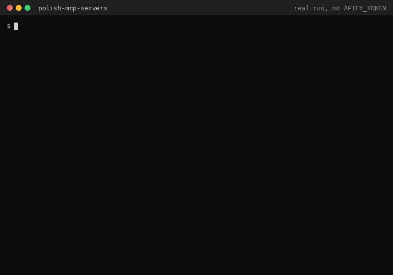

# Polish MCP servers

[](https://glama.ai/mcp/servers/kamilkaczmareksolutions/polish-mcp-servers)
[](https://www.npmjs.com/package/polish-mcp-servers)


**Give Claude, Cursor or any MCP client one-command access to Polish public data: statutes, court judgments, KRS companies, company lookup by NIP/REGON, tenders, building permits, land parcels, EV chargers, electricity prices and more (14 tools).**



<sub>Staged demo with sample output; real runs need an Apify token. The tool list is real; the company in the result is fictional, laid out the way the server returns it (`{items, truncated}` with the KRS Actor's dataset fields).</sub>

## Why

Polish public data is spread over a dozen official APIs and portals (Sejm ELI, SAOS, KRS, CEPiK, GUNB, ULDK, PSE, dane.gov.pl ...), each with its own format, paging and quirks. LLM agents can't use them out of the box. This server wraps them as MCP tools with typed input schemas and read-only annotations, so an agent can search acts, read a judgment, or pull EV chargers, building permits or electricity prices without you writing glue code.

## Quick start

```bash
npx -y polish-mcp-servers          # all 14 tools
```

Then add it to your client (Claude Desktop, Cursor, VS Code: see [Configure Claude Desktop and Cursor](#configure-claude-desktop-and-cursor)) with `APIFY_TOKEN` in `env`.

## How it works

- Stdio MCP server built on `@modelcontextprotocol/sdk`. Three profiles: `polish-mcp-servers` (all 14 tools), `polish-law-mcp` (law only), `polish-public-registers` (the other 13).
- The tool list, input schemas and descriptions come from a bundled catalog (`catalog/`), so `tools/list` needs no token and no network.
- `tools/call` runs the matching public Apify Actor with `run-sync-get-dataset-items` (pinned build, up to 300 s) on your Apify account and returns the dataset items as JSON.

## Limitations

- Every `tools/call` starts a paid Apify Actor run, billed pay-per-event to the account behind `APIFY_TOKEN` (prices below). Listing tools is free.
- Responses are capped at 100 items and 256 KiB of JSON per call.
- Data is only as fresh and complete as the upstream public source.

## Details

Local [Model Context Protocol](https://modelcontextprotocol.io) server for Polish public data. It speaks stdio and exposes 14 tools, one for each public Apify Actor by [enterprising_hamster](https://apify.com/enterprising_hamster).

`tools/list` answers with no `APIFY_TOKEN` and no network. `tools/call` runs that Actor on your Apify account. Create a token at [console.apify.com/settings/integrations](https://console.apify.com/settings/integrations) and set `APIFY_TOKEN`. A call without a token returns an MCP tool error that points at that page.

AI agents without an Apify account can buy a prepaid Apify API token at [agi.apify.com](https://agi.apify.com) (x402, MPP or Skyfire; minimum $1, expires after 14 days, unused balance is not refunded) and set it as `APIFY_TOKEN`. See [Agentic payments with x402](https://docs.apify.com/integrations/x402).

Each call returns at most 100 dataset items and at most 256 KiB of JSON. Pass `maxItems` to ask for fewer. When the Actor schema already defaults `maxItems` to 100 or less, that default stands. The law tool defaults to 20, because that Actor's schema has no `maxItems`.

## Tools

| Tool | Returns | Actor |
|---|---|---|
| `polish-law-mcp-server` | One Polish law result. Set `tool` to `search_legal_acts`, `get_legal_act`, `get_legal_act_text`, `list_changed_legal_acts`, `search_court_judgments`, or `get_court_judgment`, and pass `arguments`. | [Store](https://apify.com/enterprising_hamster/polish-law-mcp-server) |
| `polish-legal-acts-eli` | Dziennik Ustaw and Monitor Polski act metadata, with optional text. | [Store](https://apify.com/enterprising_hamster/polish-legal-acts-eli) |
| `polish-court-judgments-saos` | SAOS judgments with metadata and optional full text. | [Store](https://apify.com/enterprising_hamster/polish-court-judgments-saos) |
| `polish-eu-funds-tenders-baza-konkurencyjnosci` | EU-funds procurement notices from Baza Konkurencyjności. | [Store](https://apify.com/enterprising_hamster/polish-eu-funds-tenders-baza-konkurencyjnosci) |
| `cee-public-tenders` | Czech, Slovak, Hungarian, and Ukrainian public tenders. | [Store](https://apify.com/enterprising_hamster/cee-public-tenders) |
| `polish-ev-charging-stations-eipa` | EIPA charging stations with location, connectors, power, and live status. | [Store](https://apify.com/enterprising_hamster/polish-ev-charging-stations-eipa) |
| `polish-vehicle-registrations-cepik` | Aggregated CEPiK registration counts. No VINs or owners. | [Store](https://apify.com/enterprising_hamster/polish-vehicle-registrations-cepik) |
| `polish-building-permits-gunb` | GUNB building permits and notifications. Private investors are anonymised. | [Store](https://apify.com/enterprising_hamster/polish-building-permits-gunb) |
| `polish-land-parcels-uldk-zoning` | ULDK parcel location and area, plus MPZP and POG zoning. No owners. | [Store](https://apify.com/enterprising_hamster/polish-land-parcels-uldk-zoning) |
| `polish-healthcare-facilities-rpwdl` | RPWDL facilities with address, contact, specialties, and beds. | [Store](https://apify.com/enterprising_hamster/polish-healthcare-facilities-rpwdl) |
| `polish-developer-apartment-prices` | Developer apartment and house offers, with price per m², from dane.gov.pl. | [Store](https://apify.com/enterprising_hamster/polish-developer-apartment-prices) |
| `polish-electricity-market-pse` | PSE electricity prices and grid rows (RCE, day-ahead, imbalance, load, generation). | [Store](https://apify.com/enterprising_hamster/polish-electricity-market-pse) |
| `polish-new-companies-krs` | New and changed companies from the KRS bulletin with NIP, REGON, PKD, and share capital. No personal data. | [Store](https://apify.com/enterprising_hamster/polish-new-companies-krs) |
| `polish-company-lookup-regon` | Company lookup by NIP, REGON or KRS in the GUS REGON register: name, legal form, address, PKD, status, optional VAT status. No GUS key needed, no phone or email. | [Store](https://apify.com/enterprising_hamster/polish-company-lookup-regon) |

The full tool and parameter descriptions that clients see live in [`catalog/tool-descriptions.json`](catalog/tool-descriptions.json). Every tool is annotated `readOnlyHint: true`, `destructiveHint: false`, `idempotentHint: true`, `openWorldHint: true`: it only reads the public source, but each `tools/call` starts a paid Apify Actor run, billed pay-per-event to the Apify account behind `APIFY_TOKEN`, and waits up to 300 s for it.

`polish-mcp-servers` and `polish-mcp` list all 14. `polish-law-mcp` lists only `polish-law-mcp-server`. `polish-public-registers` lists the other 13, including `cee-public-tenders`.

## Install

From npm ([`polish-mcp-servers`](https://www.npmjs.com/package/polish-mcp-servers)):

```bash
npx -y polish-mcp-servers
```

Law only, or registers only:

```bash
npx -y --package polish-mcp-servers polish-law-mcp
npx -y --package polish-mcp-servers polish-public-registers
```

Alternative, straight from GitHub (latest `main`, no npm registry):

```bash
npx -y github:kamilkaczmareksolutions/polish-mcp-servers
npx -y --package github:kamilkaczmareksolutions/polish-mcp-servers polish-law-mcp
npx -y --package github:kamilkaczmareksolutions/polish-mcp-servers polish-public-registers
```

From a checkout, `npm install` compiles the server:

```bash
git clone https://github.com/kamilkaczmareksolutions/polish-mcp-servers.git
cd polish-mcp-servers
npm install
node dist/main.js
```

`node dist/law.js` and `node dist/registers.js` start the other two profiles.

Docker image. `tools/list` needs no secrets.

```bash
docker build -t polish-mcp-servers .
docker run --rm -i polish-mcp-servers
```

Pass the token only when you want `tools/call` to run an Actor.

```bash
docker run --rm -i -e APIFY_TOKEN=<YOUR_APIFY_TOKEN> polish-mcp-servers
```

## Configure Claude Desktop and Cursor

Claude Desktop reads `claude_desktop_config.json`. Cursor reads `~/.cursor/mcp.json` or `.cursor/mcp.json` in a project.

```json
{
  "mcpServers": {
    "polish-mcp": {
      "command": "npx",
      "args": ["-y", "polish-mcp-servers"],
      "env": {
        "APIFY_TOKEN": "<YOUR_APIFY_TOKEN>"
      }
    },
    "polish-law": {
      "command": "npx",
      "args": ["-y", "--package", "polish-mcp-servers", "polish-law-mcp"],
      "env": {
        "APIFY_TOKEN": "<YOUR_APIFY_TOKEN>"
      }
    },
    "polish-public-registers": {
      "command": "npx",
      "args": ["-y", "--package", "polish-mcp-servers", "polish-public-registers"],
      "env": {
        "APIFY_TOKEN": "<YOUR_APIFY_TOKEN>"
      }
    }
  }
}
```

Omit `APIFY_TOKEN` if you only want `tools/list`.

## Hosted servers

The same data is also available as hosted MCP servers on [Apify](https://apify.com/enterprising_hamster). Point your client at a URL and authenticate with your Apify account. Those servers still run as Apify Actors.

- **Polish Law MCP**: Polish statutes from the Sejm ELI API (Dziennik Ustaw, Monitor Polski) and court judgments from SAOS.
- **Polish Public Registers**: 12 official Polish registers (EU-funded tenders, EV charging stations, vehicle registrations, building permits, land parcels and zoning, healthcare facilities, developer apartment prices, electricity market, new companies from KRS, company lookup in REGON, legal acts, court judgments).

| Server | MCP Registry name | MCP URL (Streamable HTTP) |
|---|---|---|
| Polish Law MCP | `io.github.kamilkaczmareksolutions/polish-law-mcp` | `https://mcp.apify.com/?tools=enterprising_hamster/polish-law-mcp-server` |
| Polish Law MCP (direct, Apify Standby) | same entry, second remote | `https://enterprising-hamster--polish-law-mcp-server.apify.actor/mcp` |
| Polish Public Registers | `io.github.kamilkaczmareksolutions/polish-public-registers` | see [full URL](#polish-public-registers-url) below |

### Polish Public Registers URL

```
https://mcp.apify.com/?tools=enterprising_hamster/polish-eu-funds-tenders-baza-konkurencyjnosci,enterprising_hamster/polish-ev-charging-stations-eipa,enterprising_hamster/polish-vehicle-registrations-cepik,enterprising_hamster/polish-building-permits-gunb,enterprising_hamster/polish-land-parcels-uldk-zoning,enterprising_hamster/polish-healthcare-facilities-rpwdl,enterprising_hamster/polish-developer-apartment-prices,enterprising_hamster/polish-electricity-market-pse,enterprising_hamster/polish-new-companies-krs,enterprising_hamster/polish-company-lookup-regon,enterprising_hamster/polish-legal-acts-eli,enterprising_hamster/polish-court-judgments-saos
```

You can drop Actors from the `tools=` list to expose only the registers you need.

### Polish Law MCP tools

Apify Actor: [enterprising_hamster/polish-law-mcp-server](https://apify.com/enterprising_hamster/polish-law-mcp-server)

The hosted law server exposes six tools. The local server keeps them behind the single tool `polish-law-mcp-server`.

| Tool | What it does |
|---|---|
| `search_legal_acts` | Search acts in Dziennik Ustaw and Monitor Polski (Sejm ELI). Returns act summaries with ELI ids. |
| `get_legal_act` | Metadata of one act: status, in-force flag, key dates, issuing body, implemented EU acts, newest consolidated text, references. |
| `get_legal_act_text` | Plain text of an act or a single article, current wording from the newest consolidated text, in bounded windows. |
| `list_changed_legal_acts` | Acts whose ELI record changed since a given time (new publications, amendments, status or reference updates). |
| `search_court_judgments` | Search judgments in SAOS (System Analizy Orzeczeń Sądowych). |
| `get_court_judgment` | Full judgment: metadata, legal bases, cited regulations (with ELI ids), cited cases, summary, text in bounded windows. |

Through `mcp.apify.com` the same six tools are exposed with an Apify prefix (`enterpri--polish-law-mcp-server--…`). The Standby URL exposes them under the names above.

Pricing (pay per event, FREE/BRONZE Apify plan tier):

| Event | Price |
|---|---|
| Tool call returning search results or metadata | $0.005 |
| Tool call returning the full text of a legal act or court judgment | $0.015 |

### Polish Public Registers tools

Each Actor is exposed as one MCP tool that runs the Actor. The Apify MCP server also adds four helper tools: `get-actor-run`, `get-dataset-items`, `get-key-value-store-record`, `abort-actor-run` (16 tools in total).

Prices are per delivered result, FREE/BRONZE Apify plan tier. Higher plan tiers pay less; see each Actor page.

| Register (source) | Apify Actor | Price per result |
|---|---|---|
| EU-funds tenders (Baza Konkurencyjności) | [polish-eu-funds-tenders-baza-konkurencyjnosci](https://apify.com/enterprising_hamster/polish-eu-funds-tenders-baza-konkurencyjnosci) | $0.003 announcement; $0.008 announcement with details |
| EV charging stations (EIPA / UDT) | [polish-ev-charging-stations-eipa](https://apify.com/enterprising_hamster/polish-ev-charging-stations-eipa) | $0.003 station; $0.001 station with anonymised private operator |
| Vehicle registrations (CEPiK open data, aggregates only) | [polish-vehicle-registrations-cepik](https://apify.com/enterprising_hamster/polish-vehicle-registrations-cepik) | $0.003 statistics row |
| Building permits (GUNB RWDZ) | [polish-building-permits-gunb](https://apify.com/enterprising_hamster/polish-building-permits-gunb) | $0.002 project; $0.006 project with organisation investor |
| Land parcels and zoning (GUGiK ULDK, MPZP, POG) | [polish-land-parcels-uldk-zoning](https://apify.com/enterprising_hamster/polish-land-parcels-uldk-zoning) | $0.004 parcel; $0.02 parcel with zoning |
| Healthcare facilities (RPWDL) | [polish-healthcare-facilities-rpwdl](https://apify.com/enterprising_hamster/polish-healthcare-facilities-rpwdl) | $0.004 facility |
| Developer apartment prices (dane.gov.pl) | [polish-developer-apartment-prices](https://apify.com/enterprising_hamster/polish-developer-apartment-prices) | $0.002 offer; $0.004 price change |
| Electricity market (PSE API) | [polish-electricity-market-pse](https://apify.com/enterprising_hamster/polish-electricity-market-pse) | $0.0003 market data row |
| New and changed companies (KRS API, Ministry of Justice) | [polish-new-companies-krs](https://apify.com/enterprising_hamster/polish-new-companies-krs) | $0.004 company |
| Company lookup by NIP, REGON, KRS (GUS REGON BIR1.2) | [polish-company-lookup-regon](https://apify.com/enterprising_hamster/polish-company-lookup-regon) | $0.003 company |
| Legal acts (Sejm ELI) | [polish-legal-acts-eli](https://apify.com/enterprising_hamster/polish-legal-acts-eli) | $0.002 act metadata; $0.008 act with text |
| Court judgments (SAOS) | [polish-court-judgments-saos](https://apify.com/enterprising_hamster/polish-court-judgments-saos) | $0.003 judgment metadata; $0.01 judgment with full text |

Apify platform usage may be billed on top, depending on your Apify plan.

### Authentication and billing

Both hosted servers run under your own Apify account, and you pay for the results you request.

- **OAuth** via `mcp.apify.com`. Clients that support MCP OAuth sign you in to Apify. No token in the config.
- **Bearer token**. Send `Authorization: Bearer <YOUR_APIFY_TOKEN>`. Get the token at [console.apify.com/settings/integrations](https://console.apify.com/settings/integrations). Required for the Standby URL.

Requests without credentials get HTTP 401.

### Hosted client configuration

Replace `<YOUR_APIFY_TOKEN>` with your token, or omit `headers` if your client supports OAuth.

Claude.ai and Claude Desktop. Settings → Connectors → Add custom connector, then paste the MCP URL (for example `https://mcp.apify.com/?tools=enterprising_hamster/polish-law-mcp-server`). Sign in to Apify when prompted.

Cursor, `~/.cursor/mcp.json` or `.cursor/mcp.json` in a project:

```json
{
  "mcpServers": {
    "polish-law": {
      "url": "https://mcp.apify.com/?tools=enterprising_hamster/polish-law-mcp-server",
      "headers": {
        "Authorization": "Bearer <YOUR_APIFY_TOKEN>"
      }
    },
    "polish-public-registers": {
      "url": "https://mcp.apify.com/?tools=enterprising_hamster/polish-eu-funds-tenders-baza-konkurencyjnosci,enterprising_hamster/polish-ev-charging-stations-eipa,enterprising_hamster/polish-vehicle-registrations-cepik,enterprising_hamster/polish-building-permits-gunb,enterprising_hamster/polish-land-parcels-uldk-zoning,enterprising_hamster/polish-healthcare-facilities-rpwdl,enterprising_hamster/polish-developer-apartment-prices,enterprising_hamster/polish-electricity-market-pse,enterprising_hamster/polish-new-companies-krs,enterprising_hamster/polish-company-lookup-regon,enterprising_hamster/polish-legal-acts-eli,enterprising_hamster/polish-court-judgments-saos",
      "headers": {
        "Authorization": "Bearer <YOUR_APIFY_TOKEN>"
      }
    }
  }
}
```

VS Code, `.vscode/mcp.json`:

```json
{
  "inputs": [
    {
      "type": "promptString",
      "id": "apify-token",
      "description": "Apify API token",
      "password": true
    }
  ],
  "servers": {
    "polish-law": {
      "type": "http",
      "url": "https://mcp.apify.com/?tools=enterprising_hamster/polish-law-mcp-server",
      "headers": {
        "Authorization": "Bearer ${input:apify-token}"
      }
    }
  }
}
```

Add `polish-public-registers` the same way with its URL.

## Official MCP Registry

- `io.github.kamilkaczmareksolutions/polish-law-mcp`
- `io.github.kamilkaczmareksolutions/polish-public-registers`

Look them up at `https://registry.modelcontextprotocol.io/v0.1/servers?search=kamilkaczmareksolutions`.

## Data sources

All data comes from official Polish public registers and open-data APIs: Sejm ELI, SAOS, Baza Konkurencyjności, EIPA (UDT), CEPiK, GUNB, GUGiK ULDK, RPWDL, dane.gov.pl, PSE, KRS, GUS REGON. Personal data is limited. Building-permit investors who are private persons are anonymised, private EV station operators are anonymised, CEPiK data is aggregated (no VINs or owners), ULDK parcels come without owners, KRS rows carry company-level fields only (no board members or shareholders), and REGON rows carry no phone, fax or email.

## License

This repository is released under the [MIT License](LICENSE).
